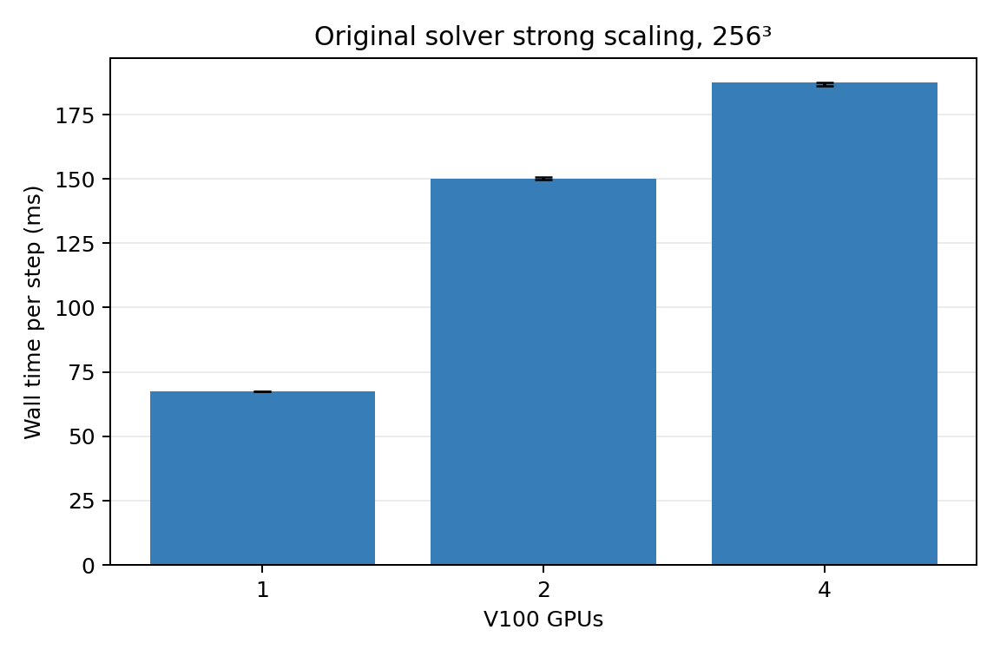

# P1-06 原始核心单机多 GPU 基线

2026-11-21，iLBMReX 原始求解器提交 `a8c7c89ccac0c90c84f3ebbf6ad59ce94a38df95`，外部 AMReX 26.11，Release、CUDA 架构 70、双精度、`AMReX_CUDA_FASTMATH=OFF`。统一使用 256³ D3Q19 TGV、`amr.max_grid_size=64`、无 plotfile/checkpoint 的输入。1、2、4 卡分别使用物理 GPU `0`、`0,2`、`0,1,2,3`；MPI 一进程一 GPU，2/4 卡按 NUMA 绑定。

`Baseline/make_timed_core.py` 只在构建目录生成原始核心的计时副本：步 101 开始前同步 GPU 并做 MPI barrier，步 600 结束后同步 GPU，按最慢进程归约耗时；计时区间没有流场写盘，但包含原求解器既有的每步质量归约和日志。全部 9 次使用相同二进制和输入，二进制 SHA-256 为 `334e543b04ab4332a6fa3c6c58b98e49af1ee6637da1ccb776b2ceb876bf775e`，输入 SHA-256 为 `e2133f763856abe868c6942643ccf224a5624497a3d2f037b023a8c3fb00fc81`。

| GPU | 500 步平均每步耗时中位数 | 3 次最小～最大 | 对单卡加速比 |
|---:|---:|---:|---:|
| 1 | 67.377 ms | 67.365～67.383 ms | 1.000 |
| 2 | 150.022 ms | 149.689～150.583 ms | 0.449 |
| 4 | 187.443 ms | 186.139～187.482 ms | 0.359 |

主基线出现负扩展。机器生成的 [9 次原始计时](tgv-strong-256.json) 保存每次命令、映射和日志路径；工作站原日志位于 `runs/tgv-strong-256/{1,2,4}gpu-r*/run.log`。这是后续优化和重组对照的未修复原始值。

单卡第 1 次是同输入、同二进制的预跑，日志移入统一运行目录后与其余 8 次一起汇总；后续复现脚本每次都会重新执行全部 9 次。

## 10 步容量

从 256³ 开始，以 64 单元边长粗搜索，再用 8 单元粒度缩小首个失败区间。每个成功结果均启动、推进 10 步且正常退出。峰值显存是运行时 `nvidia-smi` 采样的物理 GPU 显存占用；AMReX 默认 arena 预留会使它高于实际场数据用量。

| GPU | 最大成功网格 | 总格点 | 各卡峰值显存 MiB | 下一档失败 |
|---:|---:|---:|---|---:|
| 1 | 328³ | 35,287,552 | GPU0 31,095 | 336³ |
| 2 | 416³ | 71,991,296 | GPU0 31,205；GPU2 30,149 | 424³ |
| 4 | 528³ | 147,197,952 | GPU0 32,315；GPU1 31,459；GPU2 31,485；GPU3 30,921 | 536³ |

下一档均因 CUDA 显存分配失败，故不列为可用容量。完整候选网格、完成状态、输入校验值、退出码和逐卡峰值见 [容量报告](tgv-capacity.json)；原日志在工作站 `runs/tgv-capacity-search/`。这是 10 步容量边界，不代表长时稳定边界。

## 初始化与写盘

在同一 256³ 案例上分别测 `max_step=0, amr.plot_int=-1` 和 `max_step=0, amr.plot_int=1`，各三次。前者的进程墙钟时间估计初始化及启动/退出，后者额外写出约 3.2 GiB 的 t=0 plotfile。两者中位数之差估计写盘增量；这种差分包含少量进程启动和系统波动，不等同于内部 `WritePlotFile()` 的精确计时。

| GPU | 不写盘中位数 | 写 t=0 中位数 | 差分估计写盘 |
|---:|---:|---:|---:|
| 1 | 1.421 s | 3.790 s | 2.369 s |
| 2 | 1.653 s | 2.949 s | 1.296 s |
| 4 | 2.129 s | 2.849 s | 0.720 s |

[机器可读的 18 次记录](tgv-init-io-256.json) 含所有命令和日志路径，原始 plotfile 留在工作站 `runs/tgv-init-io-256/`。

## 逐位一致性早期探测

同一计时二进制运行固定的 `inputs_bitwise_128`，1、2、4 卡均在步 0 和 10 输出完整 plotfile。`tgv3d_compare` 将不同进程划分的场映射至相同全局格点，逐位比较双精度 `rho/ux/uy/uz`。1 对 2 卡、1 对 4 卡，在两步、四个场中的不一致格点数均为 **0**。原始核心的这项早期探测通过；P1-10 仍须在重组和后续改动之后复测。[比较报告](tgv-bitwise-128.json) 记录输入/二进制校验值与原日志路径。

## 独立计算与通信剖析

Nsight Systems 2023.2.3 在相同 256³ 输入上单独跟踪 20 步；这些跟踪不参与上述 500 步主计时。两卡每进程 GPU 核函数累计约 2.10 秒，其中发送缓冲打包约 39%、接收缓冲解包约 24%；四卡 rank0 核函数累计约 2.60 秒，打包约 56%、解包约 30%。单卡核函数累计约 1.57 秒，未出现这两类跨进程打包/解包主项。两卡 rank0 的 MPI wait 事件累计约 0.89 秒，四卡 rank0 约 3.07 秒。MPI 事件时长可与 GPU 工作重叠，且剖析覆盖初始化，不能直接相加成每步耗时。

工作站 Open MPI 的 `opal_built_with_cuda_support=false`。结合 Nsight 事件，通信缓冲打包、解包和 MPI 等待是负扩展的主要线索；是否由主机中转、拓扑或具体通信路径主导，留待第二阶段对照 CUDA-aware MPI 与通信实现。原始 `.nsys-rep`、SQLite 和日志保存在工作站 `runs/tgv-profile-{1,2,4}gpu/`。工作站后续优化的最低净加速门槛建议为两卡、四卡的同网格中位数均低于当前单卡的 67.377 ms/步；目标集群的正式门槛在集群基线实测后冻结。
