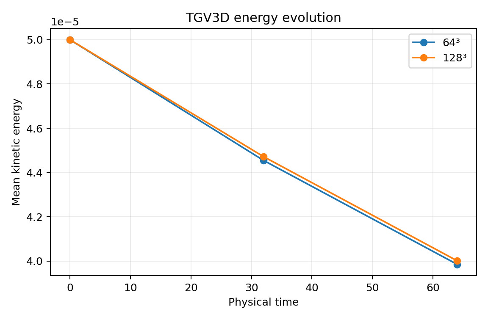

# P1-05 单卡 TGV3D 物理检查

2026-11-21 在工作站 GPU0 上，使用 `Baseline/CMakeLists.txt` 构建的原始 iLBMReX + AMReX 26.11 双精度 CUDA 版本，运行 `inputs_physics_64` 和 `inputs_physics_128`。两者均正常退出并写出 0、32、64 三个物理时间的完整 AMReX plotfile。详细机器与构建信息见 `inventory.md`；判据在运行前固定于 `Benchmarks/TGV3D/protocol.md`。

| 网格 | t | 平均密度 | 平均动能 | 初场最大绝对误差 | 非有限值 |
|---:|---:|---:|---:|---:|---:|
| 64³ | 0 | 1 | 5.0000000000001744e-5 | 1.11e-16 | 无 |
| 64³ | 32 | 1.000000000000046 | 4.4547710229516168e-5 | — | 无 |
| 64³ | 64 | 0.99999999999998734 | 3.985394202893248e-5 | — | 无 |
| 128³ | 0 | 1 | 4.9999999999973907e-5 | 2.22e-16 | 无 |
| 128³ | 32 | 0.99999999999991895 | 4.4718464865773494e-5 | — | 无 |
| 128³ | 64 | 1.0000000000001237 | 4.0014810964245322e-5 | — | 无 |

质量最大相对漂移：64³ 为 `4.60e-14`，128³ 为 `1.24e-13`，均低于 `1e-8`。两网格在 t=32、64 的平均动能相对差分别为 `0.3818%`、`0.4020%`，均低于 5%。两个网格动能均随时间下降，初始平均动能与解析值 `U0²/8=5e-5` 一致。`check_physics.py` 的 9 项检查全部通过。

机器生成的 [JSON 报告](tgv-physics.json) 和 [CSV 时序](tgv-physics.csv) 含分析器及输入 SHA-256。原始 plotfile 位于工作站 `runs/tgv-physics-64/plt*`、`runs/tgv-physics-128/plt*`；运行日志位于 `logs/tgv-physics-64.log`、`logs/tgv-physics-128.log`。两组流场分别约 151 MiB、1.2 GiB，未纳入仓库。
